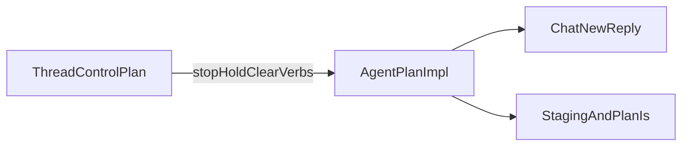

# Thread control as a preliminary to agent-plan

## Initial prompt

Can you review docs/ideas/2026/11/10-agent-plan-cursor-codex-ollaya.md in the context of the latest work done in docs/specs/asc ?

In particular, I'm inclined to think that the need for control of agent (threads) deserves to be part of this plan as a preliminary step, perhaps as a separate plan to be executed first.

Does it make sense ?

## Verdict

**Yes.** Control of ASC threads (process trees for entry points) should be a **separate plan executed before** implementing `make agent-plan`. It should not be absorbed into the Nov 10 design as another section of chat/staging contracts.

The Nov 11 specs already separate three things the Nov 10 idea still conflates in everyday language:

- **Thread** — [docs/specs/asc/agent-threads.md](docs/specs/asc/agent-threads.md): ASC-owned process tree (`data/threads/`, wrap, list, status)
- **Chat** — [docs/specs/asc/agent-chats.md](docs/specs/asc/agent-chats.md): product conversation; ASC keeps at most a pointer + turn JSON
- **Model server** — provider pivots: not a run

[docs/ideas/2026/11/10-agent-plan-cursor-codex-ollaya.md](docs/ideas/2026/11/10-agent-plan-cursor-codex-ollaya.md) is a long-running **thread** that drives **chats**. Its contracts cover the second half well (roles, staging, sandbox, `plan-is 'ready'`). They say almost nothing about supervising or stopping the first half. Observed gaps: no stop, pid-only liveness, one overwritten record per entry, no thread-chat link, and `agent-stop` still means unload a model.

Run-tracking’s constraint fits: unattended agent runs are not yet allowed. `agent-plan` is the first real multi-round unattended loop. Shipping it without stop/hold invents the failure mode in [docs/ideas/2026/11/11-agent-control-actions.md](docs/ideas/2026/11/11-agent-control-actions.md): harness children outlive the recorded pid.

## What belongs in the preliminary plan (narrow)

Derive from the Nov 11 lean, not the full idea inventory:

1. `thread-stop e:$entry` — reliable tree kill (prefer try `systemd-run --user` on one long entry first; else setsid + process group). After stop, write exited (or a decided stopped) instead of leaving running for a sweep that may never run.
2. Hold / kill switch — a file the wrapper refuses to start under. Smallest unattended gate; no daemon.
3. Naming — move or document provider lifecycle away from `agent-stop` (lean: `llm-*`) so stop the agent means the thread.
4. Cheap identity when a thread drives a chat — `run_id` on the thread record; when chat turns run, record `provider_session_id` on that thread (session-stores lean: option 2, not a `data/chats/` pointer file yet).
5. Smoke — start a disposable long entry, list it, stop the whole tree, confirm children are gone and the record is consistent.

Stopping the process must not be required to end the product session; chats remain resumable. That matches agent-plan’s headless create/resume model.

## What stays out (do not block agent-plan on these)

- Queue, priority, pause/resume, cross-host listing, central ledger, OSC 7501, herdr/tmux
- Gates / next-steps redesign
- Full chat pointer store, `chat-read` / `chat-archive` semantics
- Absorbing staging, bwrap profiles, or Cursor/Codex hooks into the thread plan

Those remain siblings; agent-plan Order of work steps 1–6 stay about chats and plans.

## Why not just add a step inside agent-plan

Mixing stop/hold/systemd into the same plan as Cursor/Codex/sandbox/readiness couples two failure domains and delays the safety surface until the end of a large delivery. A separate first plan keeps agent-plan focused on settled contracts while making “may this loop run unattended?” answerable before any provider hook lands.

## Doc updates after confirmation

1. Draft a short plan under `docs/plans/2026/11/` (e.g. `11-agent-thread-control.md`) for the narrow slice above; Related points at agent-threads, control-actions, run-tracking.
2. In the design idea: add a Prerequisite / Order-of-work step before host feasibility; link the new plan; keep sections 1–8 as chat/plan contracts.
3. In the impl plan: note that Task 0+ assume thread-stop + hold exist (dependency before Task 0); do not expand Task 0 into full thread redesign.
4. Cross-link sequencing in agent-threads.md and agent-plans.md Related sections.

## First review

The direction makes sense, but the proposal is more decisive about the solution and sequence than its evidence yet supports.

The central insight is strong: an agent loop needs to be controllable as a running process, independently of the chat sessions and plan artifacts it uses. Treating that as a distinct concern exposes a real gap in the current design. The proposed exclusions also show good discipline: a safe first slice does not need a queue, distributed control, or a complete history system.

I would, however, frame the preliminary work around an outcome—“before an unattended loop is operated, an operator can identify it, prevent new starts, and stop it with a known result”—rather than yet treating the five listed items as the necessary prerequisite. That leaves room to discover what the existing wrapper and target hosts can actually guarantee. In particular, the document calls tree termination reliable while also offering a process-group fallback whose children can escape; that is an unresolved boundary, not merely an implementation choice.

The other distinction that needs to shape the whole proposal is control versus permission. A hold file can prevent future starts; it does not stop work already running, and neither it nor a stop command establishes that unattended operation is authorized. The existing agent-plans spec already distinguishes readiness from authorization. This idea should preserve that distinction when it asks whether the loop “may” run unattended.

I’m also less convinced that the entire implementation of agent-plan must wait for this plan. A dependency before unattended or real long-running operation is persuasive; a dependency before every feasibility check, provider hook, or isolated test is not yet justified. Keeping that distinction would allow learning about both sides without deploying an uncontrolled loop.

So I would keep this as a promising direction-setting idea, not yet promote it unchanged to a definitive preliminary plan. Its next useful step is to state the minimum operational guarantee and its limits, then decide which work truly has to precede unattended use. The exact supervisor, naming change, and chat identity recording can be evaluated against that goal rather than assumed to be equally essential.

One small clarification of the premise: the cited run-tracking document reports that earlier reviews say unattended runs are not yet allowed; it does not itself establish a new authorization policy. That distinction matters because several other documents are also explicitly drafts or proposals.
